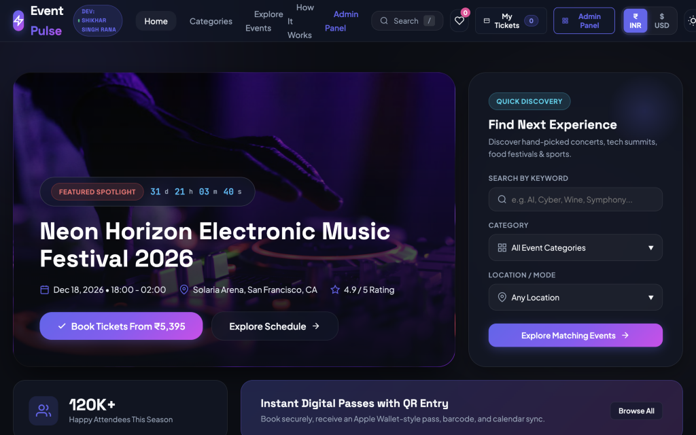

# 🎟️ EventPulse — NextGen Event Booking & Organizer Platform

> **Lead Architect & Developer:** **SHIKHAR SINGH RANA**  
> **Live Demo:** [https://shikharsinghrana0-hash.github.io/event-booking-platform/](https://shikharsinghrana0-hash.github.io/event-booking-platform/)  
> **GitHub Repository:** [https://github.com/shikharsinghrana0-hash/event-booking-platform](https://github.com/shikharsinghrana0-hash/event-booking-platform)



A modern, responsive, and trending event discovery & ticket booking platform built with vanilla HTML5, CSS3, and modern ES6 JavaScript. Designed with a luxury dark/light glassmorphic aesthetic inspired by Pinterest and Dribbble, featuring instant multi-currency switching (**₹ INR** & **$ USD**), a 4-step ticket booking wizard with 3D virtual card preview, boarding-pass ticket generation with live canvas QR code, and a full-featured **Executive Admin & Organizer Studio**.

---

## 🌟 Key Features

### 1. 🏠 Bento-Grid Homepage & Live Telemetry
- **Trending Bento Grid Layout**: Atmospheric gradient glow, glassmorphic cards (`backdrop-filter`), and floating badges.
- **Featured Event Live Countdown**: Real-time ticker counting down days, hours, minutes, and seconds to the headliner event.
- **Dynamic Category Pills**: Instant category filtering (Music, Tech & AI, Food & Wine, Arts & Theatre, Sports, Business).
- **Dual Currency Selector**: Toggle between **₹ INR (Indian Rupee)** and **$ USD (US Dollar)** with dynamic real-time price conversion across the entire website.
- **Theme Switcher**: Smooth transitions between Dark Mode and Light Mode with persistent `localStorage` state.

### 2. 🔍 Real-Time Search & Multi-Facet Filtering
- **Live Search**: Instant substring search with query match highlighting (`<mark>`) and `/` keyboard shortcut.
- **Multi-Facet Filters**: Filter by Category, Date range, and Price ranges dynamically recalculated for ₹ and $.
- **Sorting Options**: Sort by Upcoming Date, Price (Low-High / High-Low), and Popularity.
- **Grid / List View**: Switch between visual 3-column bento grid and dense horizontal listing cards.

### 3. 📄 Detailed Event Modal
- **Comprehensive Event Overview**: Full agenda breakdown, schedule timeline, speaker/artist roster, and organizer badges.
- **Venue & Map Preview**: Venue address, interactive map placeholder, and directions.
- **Ticket Tier Selection**: General Admission, VIP Lounge Pass, and Backstage Patron Pass with live availability indicators.

### 4. 🎫 4-Step Interactive Booking Wizard
- **Step 1 - Ticket Selection**: Tier selector with live stepper controls and subtotal calculation.
- **Step 2 - Attendee Information**: Form validation for full name, email address, and phone number with stored profile pre-fill.
- **Step 3 - Secure Checkout & 3D Virtual Card**:
  - Interactive 3D credit card preview that reflects typed card details and flips for CVV.
  - Promo code engine supporting `EARLY20` (20% off) and `STUDENT50` (50% off).
  - Alternative payment buttons for Apple Pay, Google Pay, and PayPal.
- **Step 4 - Digital Boarding Pass & Confirmation**:
  - Full-screen celebration with pure JavaScript canvas particle confetti.
  - Perforated luxury boarding pass with booking reference.
  - Mathematical HTML5 canvas QR code & barcode generator (zero external dependencies).
  - Export to `.ics` calendar file for Google Calendar, Apple Calendar, and Outlook.
  - Print / Save as PDF styling (`@media print`).

### 5. ⚡ Executive Organizer Studio (Admin Panel)
- **Overview & Analytics**:
  - Real-time gross revenue, ticket volume, active events count, and conversion rate.
  - Responsive 7-day SVG spline revenue velocity chart with gradient area fills and hoverable telemetry points.
- **Manage Events**: Complete roster table showing occupancy progress bars, public page preview, and live deletion.
- **Attendees & Gate Check-In**:
  - Live search across booked attendees by name, email, or order reference.
  - Status filtering (`Checked-In Only` vs `Pending Only`).
  - One-click **Gate Check-In** button for real-time ticket validation.
- **Financials & Payouts**:
  - Gross revenue, 8% platform fee calculation, and net organizer payout.
  - Simulated merchant commercial checking account integration with instant payout triggers.
- **Publish New Event**: Modal allowing organizers to publish new events that immediately show on the live platform.

---

## 🛠️ Technology Stack

- **HTML5**: Semantic markup, dialogs, canvas drawing, accessible ARIA roles.
- **CSS3**: Custom design system, CSS variables, Glassmorphism, CSS Grid & Flexbox, 3D CSS transforms.
- **Vanilla ES6+ JavaScript**: Clean modular structure, `localStorage` persistence, debounced search, custom SVG chart generation, pure canvas confetti and QR algorithms. Zero bulky external JS frameworks needed!

---

## 🚀 Getting Started

### Option 1: Direct Browser Access
Simply open [index.html](index.html) in any modern web browser (Google Chrome, Apple Safari, Mozilla Firefox, or Microsoft Edge).

### Option 2: Local HTTP Server
Run with Python:
```bash
python3 -m http.server 3000
```
Or with Node.js:
```bash
npx serve . -l 3000
```
Then visit **`http://localhost:3000`** in your browser.

---

## 📁 Project Structure

```
├── index.html              # Main single-page application & modals
├── css/
│   └── style.css           # Glassmorphic UI styling, themes, animations & print styles
├── js/
│   ├── events-data.js      # Initial event catalog, categories, and currency conversion
│   ├── booking.js          # Wizard logic, promo engine, canvas QR code & confetti
│   ├── admin.js            # Admin analytics, SVG chart, event publisher & gate check-ins
│   └── app.js              # State manager, search/filters, theme & currency controllers
├── package.json            # Project metadata & convenience scripts
├── .gitignore              # Ignored files
└── README.md               # Documentation
```

---

## 🔑 Demo Promo Codes

- **`EARLY20`**: Unlocks 20% discount on all ticket tiers.
- **`STUDENT50`**: Unlocks 50% discount for student passes.

---

## 👨‍💻 Developer & Author

**SHIKHAR SINGH RANA**
- **GitHub:** [@shikharsinghrana0-hash](https://github.com/shikharsinghrana0-hash)
- **Repository:** [event-booking-platform](https://github.com/shikharsinghrana0-hash/event-booking-platform)
- **Role:** Full-Stack Architecture, UI/UX Design, and Engineering

---

## 📄 License
This project is open-source and available under the [MIT License](LICENSE).
